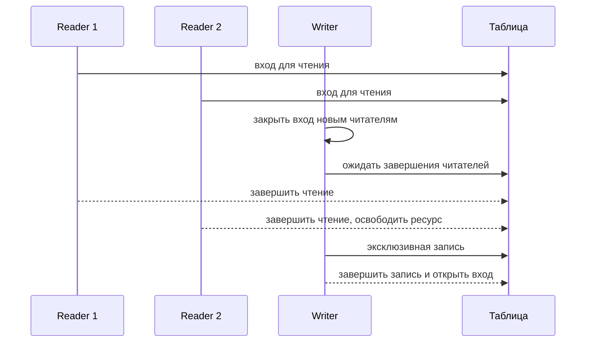

# Писатели и читатели: схема для обсуждения

## Задача

Два процесса Reader и два процесса Writer используют общую таблицу из 100 записей. Одновременно могут читать оба читателя. При записи у писателя эксклюзивный доступ ко всей таблице. Это учебная схема с приоритетом ожидающих писателей, а не копия реализации `sync.RWMutex` в Go.

## Общие объекты

Таблица и счётчики находятся в именованной общей памяти. Именованные объекты Windows доступны всем участникам:

| Объект | Назначение |
|---|---|
| `readers_mutex` | Защищает счётчик активных читателей `readers`. |
| `writers_mutex` | Защищает счётчик ожидающих или работающих писателей `writers`. |
| `read_gate` | Семафор 0/1, разрешающий новым читателям входить; изначально 1. |
| `resource` | Семафор 0/1 доступа к таблице; изначально 1. |

Mutex освобождает тот же поток, который его захватил. Семафор подходит для передачи разрешения между процессами: первый читатель может занять `resource`, а последний — освободить.

## Читатель

1. Ожидает `read_gate`, затем захватывает `readers_mutex`.
2. Увеличивает `readers`. Если он первый, ожидает `resource`, пока удерживает `readers_mutex`.
3. Освобождает `readers_mutex` и `read_gate`; читает таблицу. Другой читатель может читать одновременно.
4. Для имитации длительности чтения вызывает `Sleep(read_ms)`, пока доступ на чтение ещё удерживается. Задержка моделирует работу, а не синхронизирует процессы.
5. Захватывает `readers_mutex`, уменьшает `readers`. Последний читатель освобождает `resource`; затем читатель освобождает `readers_mutex`.

## Писатель

1. Захватывает `writers_mutex`, увеличивает `writers`. Первый ожидающий писатель захватывает `read_gate`, закрывая вход новым читателям; затем освобождает `writers_mutex`.
2. Ожидает `resource`: уже допущенные читатели должны закончить, а другой писатель — освободить таблицу.
3. Эксклюзивно изменяет записи, после чего освобождает `resource`.
4. Захватывает `writers_mutex`, уменьшает `writers`. Последний писатель освобождает `read_gate`; затем освобождает `writers_mutex`.

Короткое удержание `read_gate` читателем при входе позволяет писателю закрыть вход, не прерывая уже допущенных читателей. Порядок пробуждения ожидающих процессов Windows не следует считать гарантированно FIFO.

## Сценарии

## Корректность и ограничения

`resource` принадлежит либо группе читателей, либо одному писателю; поэтому чтение и запись не пересекаются и несколько писателей не пишут одновременно. Счётчики меняются под соответствующими mutex. Программа дополнительно проверит эти условия и согласованность записей.

При непрерывном потоке писателей читатели могут голодать. Приоритет не гарантирует очередности или максимального времени ожидания. Ограничение длительности эксперимента обнаруживает зависание.

Если процесс аварийно завершится во время владения объектом или изменения счётчиков, состояние протокола может оказаться непригодным для продолжения. Считаем такую сессию неуспешной, всё прекращаем и освобождаем ресурсы после завершения участников.

## Эксперимент

Сравниваем несколько значений `read_ms`, включая короткую и длинную задержку, при одинаковых остальных параметрах. Для каждой конфигурации — не менее трёх запусков. Фиксируем общее время и ожидание доступа писателями, число операций, тайм-аутов и нарушений. Границы измерений и режим журнала согласуем в RFC. Значения и результаты эксперимента не задаются этим документом.
