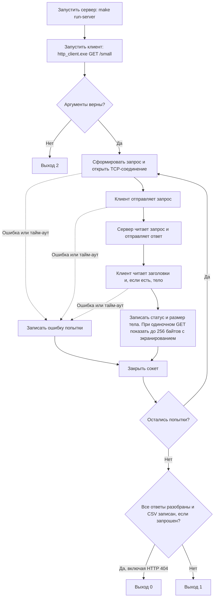

# RFC: ЛР №5, вариант 26 — HTTP/1.1-клиент

Статус — согласовано, клиент реализован. Сетевая проверка и замеры на Windows впереди.

## Цель и границы

Windows-клиент отправляет `GET` и `HEAD` по TCP, разбирает HTTP-ответ и выводит статус, заголовки и размер полученного тела. Клиент пишем на C++17 с Winsock, собираем через CMake. Для проверок запускаем отдельный Go-сервер с `net/http`.

Клиент принимает числовой IPv4 и открывает новое соединение для каждого запроса. В MVP только HTTP/1.1 без HTTPS, DNS, перенаправлений и т.п.

## Интерфейс и ход работы

```text
cd lr-5

# start go server
go run ./server/main.go [-host <ipv4>] [-port <port>]

# start cpp client
http_client.exe GET|HEAD <path> [--host <ipv4>] [--port <port>]
                              [--timeout-ms <ms>] [--count <n>] [--csv <path>]
```

| Параметр | Клиент | Сервер | Допустимые значения |
|---|---|---|---|
| Адрес | `--host`, по умолчанию `127.0.0.1` | `-host`, по умолчанию `127.0.0.1` | Числовой IPv4 |
| Порт | `--port`, по умолчанию `20112` | `-port`, по умолчанию `20112` | 20000–29999. По умолчанию `20000 + STUDENT_ID`, где `STUDENT_ID = 112` |
| Тайм-аут | `--timeout-ms`, по умолчанию 3000 мс на попытку | 5 с на заголовки, 10 с на чтение, запись и простой | Клиент — 1–60000 мс. На сервере значения заданы в коде |
| Число запросов | `--count`, по умолчанию 1 | Принимает запросы до остановки | Клиент — 1–10000 |
| Метод и путь | Обязательные, например `GET /small` | Определяет ответ по методу и пути | `GET` или `HEAD`. Путь начинается с `/`, до 2048 печатных ASCII-байтов, без пробелов и `#` |
| CSV | `--csv <path>`, по умолчанию выключен | — | Путь к файлу результатов |



## HTTP-запрос и ответ

HTTP/1.1 задаёт конец строки как `CRLF` (`\r\n`). После последнего заголовка отправляем пустую строку, поэтому запрос заканчивается на `\r\n\r\n`. Получателю разрешено принимать одиночный `\n` как послабление при разборе. Мы отправляем стандартный разделитель. [RFC 9112, § 2.1–2.2](https://www.rfc-editor.org/rfc/rfc9112.html#section-2.1)

```http
GET /small HTTP/1.1
Host: 127.0.0.1:20112
Connection: close

```

Клиент повторяет `send`, пока запрос не отправлен целиком. На приёме ищет `CRLFCRLF` даже на стыке двух чтений, разбирает статус и заголовки. Имена заголовков сравнивает без учёта регистра. Часть тела из того же буфера сразу учитывает. [RFC 9112, § 2–3](https://www.rfc-editor.org/rfc/rfc9112.html#section-2)

- `HEAD`, `204` и `304` заканчиваются на заголовках. У `HEAD` поле `Content-Length` может содержать размер тела для соответствующего `GET`.
- Если ответ содержит тело и задан `Content-Length`, читаем ровно столько байтов. Допускаем одно десятичное значение без знака и переполнения. Закрытие раньше указанной длины — ошибка.
- Для ответа с телом отклоняем `Transfer-Encoding` (включая `chunked`) и `Content-Encoding`, отличный от `identity`. Если длина и `Transfer-Encoding` отсутствуют, читаем до штатного EOF. При таком способе сам EOF не подтверждает полноту тела. Ответы `1xx` вне поднабора. [RFC 9112, § 6.3](https://www.rfc-editor.org/rfc/rfc9112.html#section-6.3)

Лимиты клиента — 32 КиБ на строку статуса с заголовками и 16 МиБ на тело. Тело читаем через буфер 8 КиБ и считаем байты без хранения всего ответа.

Сервер отдаёт `200` для `/small` (1 КиБ), `/large` (1 МиБ) и `/empty` (0 байтов). Неизвестный путь даёт `404`, другой метод — `405` с `Allow: GET, HEAD`. Для `GET` сервер задаёт `Content-Length` и отправляет тело, для `HEAD` оставляет статус и заголовки. На `/slow` сервер ждёт секунду перед ответом, а `GET /chunked` возвращает тело с `Transfer-Encoding: chunked`.

## Winsock, журнал и завершение

`WSAStartup` запускает Winsock 2.2. Клиент использует `InetPtonA` и `htons` для адреса и порта, создаёт TCP-сокет IPv4 и включает неблокирующий режим через `ioctlsocket(FIONBIO)`. При отложенном `connect` ждёт через `select` и проверяет `SO_ERROR`. При `WSAEWOULDBLOCK` на чтении или записи снова ждёт готовности. Все ожидания используют остаток одного тайм-аута на попытку. [Microsoft Learn — connect](https://learn.microsoft.com/en-us/windows/win32/api/winsock2/nf-winsock2-connect) · [Microsoft Learn — select](https://learn.microsoft.com/en-us/windows/win32/api/winsock2/nf-winsock2-select)

При сетевой ошибке выводим функцию, код и описание. `WSAGetLastError` читаем сразу, у `WSAStartup` код берём из результата, у отложенного подключения — из `SO_ERROR`. Тайм-ауты и ошибки HTTP показываем отдельно. Каждый сокет закрываем через `closesocket`, затем вызываем `WSACleanup`. В CMake линкуем клиент с `ws2_32`. В MSVC это импортная библиотека `Ws2_32.lib` из Windows SDK. При запуске функции Winsock предоставляет системная `Ws2_32.dll`. Клиент напрямую вызывает Winsock для сети и WinAPI для таймера, а для аргументов, разбора HTTP и CSV использует стандартную библиотеку C++. Сервер использует Go `net/http`. [Microsoft Learn — WSAStartup](https://learn.microsoft.com/en-us/windows/win32/api/winsock2/nf-winsock2-wsastartup)

Клиент выводит время, роль, PID, адрес и порт сервера, операцию, номер попытки и результат. Go-сервер пишет через `slog` номер запроса, адрес клиента, метод, путь и статус. Сервер обслуживает клиентов одновременно. По Ctrl+C прекращает приём новых соединений и даёт активным запросам до пяти секунд на завершение.

## Структура

- `src/main.cpp` — аргументы и цикл запросов.
- `src/socket_io.h/.cpp` — Winsock, ожидание, отправка и приём.
- `src/http.h/.cpp` — запрос, разбор ответа и подсчёт байтов тела.
- `src/results.h/.cpp` — журнал, измерения и CSV.
- `server/main.go` — локальный сервер. `CMakeLists.txt` и `USAGE.md` — сборка клиента и команды для Windows.

## Проверки и измерения

На Windows проверяем `GET` для `/small`, `/large`, `/empty` и неизвестного пути, `HEAD` для `/small` и неизвестного пути. Отдельно запускаем клиент без сервера, проверяем `/slow` с тайм-аутом 200 мс, три одновременных клиента и остановку сервера.

На `/large` тело приходит за несколько чтений. На `GET /chunked` проверяем диагностику неподдерживаемого кодирования.

Для `GET` и `HEAD` сравниваем ответы `200` и `404` и ресурсы разного размера. Для каждой пары метода и пути делаем три запуска по 100 запросов и сохраняем отдельный CSV на запуск в `measurements/lr5/`. Тайм-ауты и другие ошибки проверяем отдельно. [Команды запуска](USAGE.md)

`QueryPerformanceCounter` и `QueryPerformanceFrequency` измеряют подключение от вызова `connect` до результата и всю попытку от создания сокета до проверки ответа или ошибки. Закрытие сокета, вывод и запись CSV происходят после замера. Время попытки включает работу сервера на loopback.

В CSV одна строка на попытку. Поля — `run_id`, номер, адрес, порт, метод, путь, статус HTTP, исход, стадия ошибки, время подключения и попытки в мс, байты отправленного и принятого HTTP и байты тела. Полноту запроса и ответа отмечаем отдельно. Отсутствующие статус и время оставляем пустыми.

По CSV считаем запросы, полные ответы, успешные операции, ошибки, тайм-ауты, среднее время и объём обмена. Скорость получения тела — сумма байтов завершённых `GET`, делённая на сумму времени этих попыток. Строим два графика по размерам ресурсов для `GET` и `HEAD` — время попытки и объём принятых HTTP-байтов. В объём входят HTTP-заголовки и тело.
